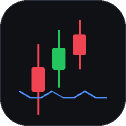

# TradeSome · 本地量化交易工作站

> 一个**完全本地、零第三方运行时依赖**的桌面量化工具：行情 → 策略 → 回测 → 模拟盘 / 实盘 → 报告，
> 全流程在一个窗口里完成。适合第一次接触量化交易、又想看清楚每一步在做什么的人。



> ⚠️ **重要声明**：本软件用于学习与研究，不构成投资建议。模拟盘不接真实资金；**实盘默认关闭**，
> 需要你自己安装并登录 QMT/miniQMT，每一笔真实委托都要在界面上二次确认。
> 历史回测不代表未来收益，实盘可能亏损。股市有风险，入市需谨慎。
> 详见 [安全设计](docs/06-安全设计.md)、[实盘接入设计](docs/14-实盘接入设计.md) 与软件内「帮助」。

---

## 1. 三分钟跑起来

### 环境
- Windows 10/11（主力支持），Python **3.9+**（自带 tkinter 与 sqlite3 即可）
- 软件本体不依赖 pip 包、不需要数据库服务，可离线启动；「同步真实行情」首次会自动安装 `akshare`（需联网，不需要你执行命令）

### 启动
1. 双击 **`start_tradesome.cmd`**；
2. 或者打开命令行，在项目根目录执行：

   ```bat
   python -m tradesome
   ```

3. 第一次启动是**空库**，不会自动生成行情。去「数据中心 → 同步真实行情」抓真实日线（首次会自动安装 akshare，需要联网），或导入 CSV。
4. 若想看到控制台日志与完整报错，改用 `tradesome_debug.cmd`。
5. `start_tradesome.cmd` 需要 `python.exe`（或 `pythonw.exe`）在 PATH 上；双击后若没有任何窗口，先用 `tradesome_debug.cmd` 看报错，或确认安装 Python 时勾选了「Add Python to PATH」。

卸载 = 删除整个文件夹；用户数据都在 `var/` 下，删掉即可彻底清理。

### 第一次使用的推荐路线

| 步骤 | 去哪里 | 做什么 |
| --- | --- | --- |
| 1 | 概览 | 看一眼权益曲线与「三步上手」 |
| 2 | 数据中心 | 同步全部 A 股 / 单只多年日线 / 导入 CSV |
| 3 | 行情 | 选标的看 K 线，确认数据正常 |
| 4 | 策略库 | 读策略说明；点「新建策略」用模板或自由组合保存自己的策略，不写文件 |
| 5 | 回测 | 勾 2~3 个标的，点「开始回测」，看收益/回撤/逐笔交易 |
| 6 | 实验室 | 拖参数试跑；满意后回策略库保存成自己的策略 |
| 7 | 模拟盘 | 用历史行情"回放"真实下单链路，观察持仓与订单 |
| 8 | 风控 | 看八条规则与熔断开关，理解钱是怎么被保护住的 |
| 9 | 实盘（可选） | 先在「设置 → 实盘」开启，再在实盘页解锁、连接模拟柜台或迅投 QMT；不开启不影响其它功能 |

> 实盘不是必经步骤。想先熟悉真实链路，可以在实盘页选择「模拟柜台」——它走的是和 QMT 完全相同的
> 网关契约、风控与审计，只是不连券商。

---

## 2. 功能一览

- **行情**：全市场 5000+ 只可搜索；选中个股自动补齐历史日线；日/周/月 K 线 + MA5/MA20 + 成交量；
  滚轮缩放、拖动平移、双击重置，X/Y 轴与成交量随可见窗口重算。
- **数据**：接入 akshare 同步真实日线（股票/ETF/指数；首次启动自动安装，失败可重试）；CSV 导入/导出；数据质量检查（OHLC 矛盾、重复、缺口、异常涨跌）；一键清空测试数据。
- **策略**：6 个内置实盘常用策略 + 策略工坊自定义策略（选模板、调参数、加止损/止盈/趋势过滤）；还可以「自由组合」从零搭 1–4 个入场条件与退出规则。保存即可用，不写文件、不执行用户代码。
- **回测**：手续费/印花税/过户费/滑点/成交量占比、T+1、涨跌停、风控接入；权益、回撤、逐笔交易、19 项指标。
- **走查验证**：滚动窗口（walk-forward）把训练段与验证段分开，避免"一套参数用到黑"。
- **模拟盘**：历史行情回放 + 真实的下单/撮合/风控/账户链路，支持暂停、继续、停止。
- **实盘（A 股）**：双界面设计，模拟盘与实盘互不影响。内置「模拟柜台」用于演练；接真实券商时在进程内
  调用 QMT/miniQMT 自带的 `xtquant`（不需要 vnpy），券商密码由客户端保管，本软件只存目录与资金账号。
  实盘需在设置中开启、每次启动重新解锁、下单二次确认；只发限价单，市价单会转成保护价限价。
- **风控**：单笔/单标的/总仓位、当日亏损、回撤降档与停机、下单频率、价格偏离、交易时段，共 8 条规则 + 熔断；
  实盘与模拟盘复用同一套规则与审计。
- **报告**：一键导出 Markdown 报告、权益 CSV、成交 CSV。
- **界面**：默认 macOS 风格（系统分组背景、白卡片圆角、胶囊按钮、滑动开关），另带深色主题；字号缩放、快捷键、空状态引导、危险操作二次确认。

### 内置策略

| key | 名称 | 类型 | 一句话 |
| --- | --- | --- | --- |
| `ma_cross` | 双均线交叉 | 趋势 | 快线上穿慢线买入，下穿卖出，可加长期趋势过滤 |
| `boll_reversion` | 布林带均值回归 | 震荡 | 跌破下轨买、回到中轨卖，适合箱体行情 |
| `rsi_reversal` | RSI 超卖反转 | 反转 | RSI 低位回升买入，高位回落卖出 |
| `grid` | 网格交易 | 网格 | 按价格台阶分批买、分批卖，赚波动不赌方向 |
| `momentum_rotation` | 动量轮动 | 轮动 | 持有近期涨幅最强的标的，定期换仓 |
| `sentiment_boost` | 情绪增强 | 复合 | 均线方向 + 放量确认，降低假突破 |

### 新建一个自己的策略（不用写文件）

1. 策略库 → 右上角「新建策略」；
2. 两种方式二选一：
   - **从模板开始**：填名称、选模板、调参数；
   - **自由组合**：从零搭 1–4 个入场条件（均线金叉/突破/RSI/布林下轨/动量/放量）+ 至少一条退出（止损/止盈/跌破均线/最长持有）；
3. 模板模式可按需设置「风控止损 / 风控止盈 / 风控趋势均线」，填 0 关闭；
4. 「保存并可用」——策略立刻出现在回测、模拟盘、实盘的下拉框里，重启后仍在。

档案是 SQLite 里的 JSON，不是 `.py` 文件。设计说明见 [策略工坊设计](docs/15-策略工坊设计.md)。

需要写自定义指标时，仍可直接写策略类（进阶）：全部内置策略源码在 `tradesome/strategy/builtin/`，规范见 [策略开发规范](docs/05-策略开发规范.md)，示例模板在 `assets/templates/my_dual_ma.py`。

### 接实盘（A 股）

TradeSome 不依赖 vnpy，也不打包任何 C++ 交易接口；它直接调用 QMT 客户端自带的
`xtquant` Python 包（随 miniQMT 安装，不需要 pip install）：

1. 在券商开通 QMT/miniQMT 权限，安装并登录 QMT 客户端，保持运行；
2. 找到它的 `userdata_mini` 目录（例如 `D:\QMT\userdata_mini`）；
3. 打开 TradeSome →「设置 → 实盘」打开开关，填目录、资金账号、账号类型；
4. 「实盘」页勾选风险提示、输入「实盘交易」解锁；
5. 柜台选「迅投 QMT」，确认目录/账号，点连接；账户、持仓、委托、成交会通过柜台回报同步；
6. 下单只支持限价单；每次下单会二次确认，单笔上限、每日笔数、风控与熔断全部生效；紧急停止会先撤单再断开。

券商密码由 QMT 客户端保管，TradeSome 只保存目录与资金账号。没有 QMT 也可以先用
「模拟柜台」把整套流程走一遍——它和 QMT 走同一个网关契约、同一套风控与审计。
订单生命周期、对账与安全边界见 [实盘接入设计](docs/14-实盘接入设计.md)。

---

## 3. 数据与 CSV 格式

演示数据由本地合成器生成（固定随机种子，可复现），**不代表任何真实标的的历史走势**。

导入 CSV 约定（UTF-8 或 GBK，逗号/制表符分隔，表头大小写不敏感）：

```csv
date,open,high,low,close,volume
2024-01-02,1680.0,1712.5,1675.0,1705.3,31200
```

- `date` 支持 `2024-01-02`、`2024/1/2`、`20240102`；
- 成交量单位是**股**；缺列会给出明确错误；
- 文件名（不含扩展名）会作为标的代码，如 `600519.SH.csv`。

导出文件默认落在 `var/exports/`，示例文件见 `assets/600519.SH.csv`。

---

## 4. 目录结构

```text
tradesome/            应用源码
  core/               类型、配置、事件总线、日历、日志（无 UI 依赖）
  security/           密钥、脱敏、输入校验、路径沙箱
  data/               数据仓库、合成/CSV 提供者、质量检查、重采样
  strategy/           策略基类、指标、注册表、工坊档案与动态策略、沙箱、内置策略
  portfolio/          账户、持仓、成本与滑点
  risk/               风控规则、风控管理器
  execution/          撮合、模拟券商、订单路由、模拟盘引擎（券商协议在此）
  gateway/            实盘网关：消息契约、模拟柜台、迅投 QMT（xtquant）
  trading/            委托状态机、实盘 Broker、实盘行情视图
  backtest/           回测引擎、指标、走查
  persistence/        SQLite 迁移与仓库（v2 含实盘字段与事件表）
  app/                容器装配、六个应用服务（含实盘交易）、路径与引导
  ui/                 主题、控件、图表、主窗口、11 个页面
doc/                  量化交易知识总结（学习材料）
docs/                 18 份软件工程文档（需求/架构/安全/性能/测试/实盘/策略工坊/自由组合与引导/真实行情/交付验收…）
assets/               图标、示例 CSV、策略模板
tests/                unit / integration / ui 三层测试
tools/                图标与截图、性能基准、打包
var/                  运行时数据（数据库、日志、导出、用户策略、密钥）
```

分层依赖是单向的：`ui → app → (trading/gateway/backtest/execution/risk/portfolio/strategy/data) → core`，
`core` 不反向依赖任何上层；`gateway` 只讲协议，`trading` 只做状态与适配，二者都不依赖 UI。
每个模块都可以单独替换，详见 [系统架构设计](docs/02-系统架构设计.md)。

---

## 5. 开发与验证

```bat
:: 全部测试（标准库 unittest，无需 pytest）
python -m unittest discover -s tests -t .

:: 只跑某一层
python -m unittest tests.unit.test_backtest
python -m unittest tests.integration.test_services
python -m unittest tests.ui.test_ui_smoke

:: 生成图标与示例 CSV（需要 pillow）
python tools\build_assets.py

:: 命令行辅助
python -m tradesome --version
python -m tradesome demo-data --force
python -m tradesome backtest --strategy ma_cross --symbols 600519.SH
python -m tradesome selftest
```

安全相关约定：所有外部输入先校验；文件路径统一走 `safe_join`；日志与导出统一脱敏；
用户策略在受限命名空间中执行；危险操作需要二次确认。细节见 [安全设计](docs/06-安全设计.md)。

---

## 6. 打包成独立 exe（可选）

```bat
python -m pip install pyinstaller
python tools\build_exe.py
```

产物在 `dist\TradeSome\TradeSome.exe`，可整个文件夹拷到没有 Python 的机器上运行。
打包脚本会自动带上 `assets/`、`doc/`、`docs/`；数据库与日志仍写在 exe 同级的 `var/`。

---

## 7. 文档索引

- [量化交易知识总结](doc/量化交易知识总结.md)：从"股票是什么"讲到策略、风控、回测陷阱
- [文档索引与阅读指南](docs/00-文档索引与阅读指南.md)
- [产品需求规格说明](docs/01-产品需求规格说明.md)
- [系统架构设计](docs/02-系统架构设计.md)
- [领域模型与数据契约](docs/03-领域模型与数据契约.md)
- [模块设计说明](docs/04-模块设计说明.md)
- [策略开发规范](docs/05-策略开发规范.md)
- [安全设计](docs/06-安全设计.md)
- [性能设计](docs/07-性能设计.md)
- [UI/UX 设计规范](docs/08-UI-UX设计规范.md)
- [测试计划](docs/09-测试计划.md)
- [部署运维与用户手册](docs/10-部署运维与用户手册.md)
- [编码规范与工程实践](docs/11-编码规范与工程实践.md)
- [架构决策记录与任务树](docs/12-架构决策记录与任务树.md)
- [策略工坊设计](docs/15-策略工坊设计.md)：模板 + 参数 + 风控叠加层，不写文件
- [交付验收报告](docs/13-交付验收报告.md)：需求对照、338 个测试、缺陷清单、已知限制、十分钟验收
- [新手引导与自由组合策略设计](docs/16-新手引导与自由组合策略设计.md)：条件 DSL、三层引导
- [真实行情接入设计](docs/17-真实行情接入设计.md)：akshare 同步、CSV 清洗、清空测试数据
- [实盘接入设计](docs/14-实盘接入设计.md)：网关契约、订单状态机、对账、安全边界、QMT 接入步骤

---

## 8. 常见问题

**Q：实盘需要什么？会不会偷偷下单？**
A：需要一台能登录 QMT/miniQMT 的 Windows 机器、券商开通的 QMT 权限，以及 QMT 客户端提供的
`xtquant`。TradeSome 默认关闭实盘，每次启动都要重新解锁，下单必须二次确认，只发限价单；
没有登录 miniQMT 就不会有任何真实委托。
券商密码由 QMT 客户端保管，TradeSome 只保存目录与资金账号。
详见 [实盘接入设计](docs/14-实盘接入设计.md)。

**Q：模拟盘和实盘有什么区别？**
A：撮合与账户来源不同：模拟盘用历史 K 线回放 + 本地撮合；实盘用券商回报 + 本地对账。
风控（8 条规则）、订单路由、审计、界面交互完全复用，所以先在模拟柜台练熟，再接真实柜台。

**Q：回测赚钱，模拟盘却亏？**
A：先看是否用了未来数据（`on_bar` 只能看到当前 bar 及之前）、手续费/滑点是否设得太乐观、
样本是否只覆盖单边行情。走查验证（walk-forward）能暴露大部分过拟合。

**Q：数据从哪来？**
A：默认是本地合成数据，只用于验证流程；真实历史数据请用 CSV 导入，格式见上文。

**Q：Windows 缩放到 125%/150% 后界面发虚？**
A：从 1.3 起进程会声明 Per-Monitor DPI 感知，并在启动时读取实际 DPI 缩放布局，
文字与边框按物理像素绘制，不再被系统位图拉伸。若仍觉得小/大，可在「设置 → 外观 → 字号缩放」
单独调整，两者互不干扰。

**Q：改了配置想恢复？**
A：「设置 → 恢复默认」逐节还原；也可以直接删除 `var/settings.json` 后重启。

**Q：实盘断线了会怎样？**
A：客户端每 3 秒心跳，10 秒没有消息会判定断线并自动重连；断线时在场委托标记为「待确认」（UNKNOWN），
不会假装成功或失败。重连后会拉取账户/持仓/委托做对账，差异写进实盘事件表。此时建议先「紧急停止」再人工核对。

**Q：自动交易什么时候跑？**
A：默认只在交易日 14:55 触发一次（可在设置修改时间），且必须已经解锁、连接并开启「允许自动交易」。
它和手动下单走同一条风控与审计链路；停牌、无行情或数据缺口会直接放弃，不会用旧价格硬下单。
